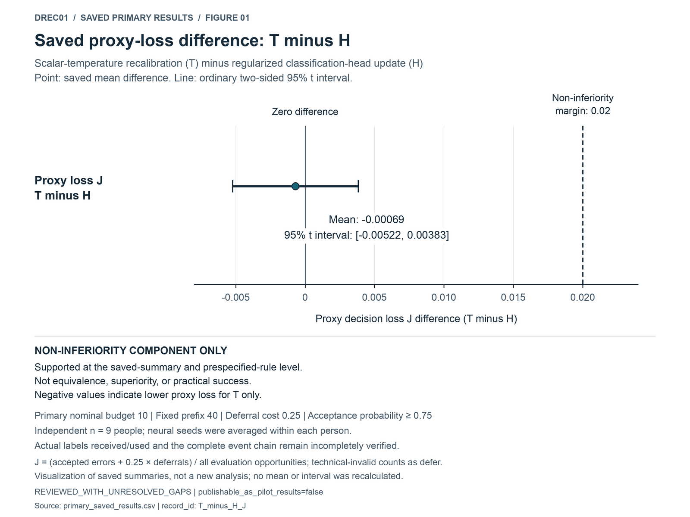
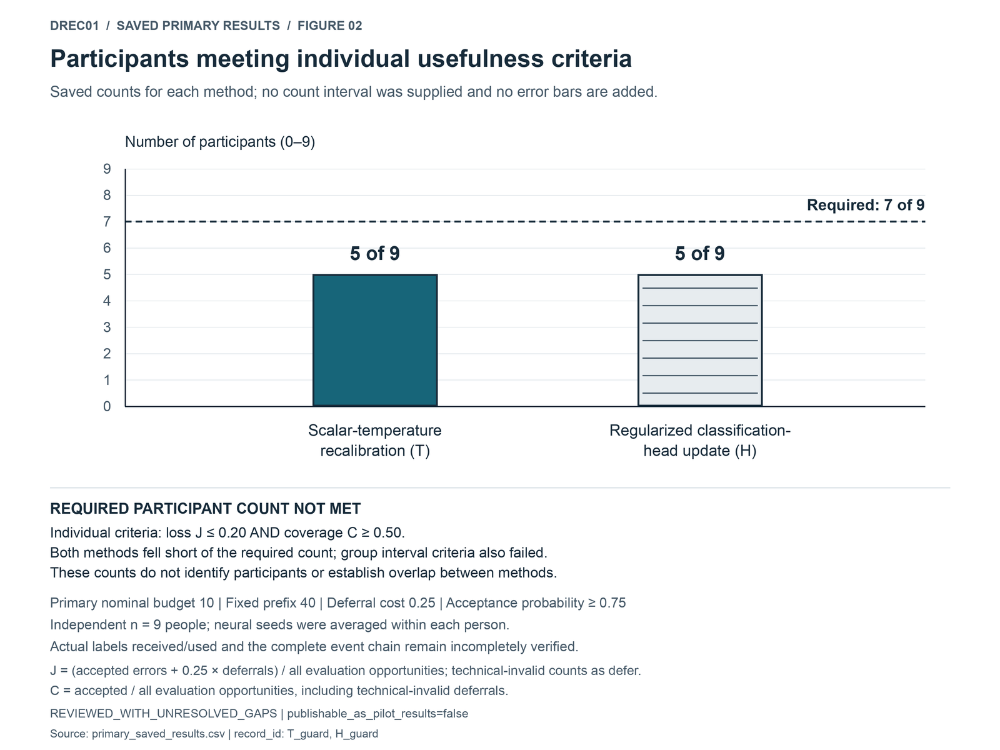

# EEG Cross-Session Adaptation — A Bounded Preliminary Analysis

**Shang-Wei Hung · Limited preliminary analysis · Work in progress**

How much can a small amount of session-specific feedback improve an EEG decoder's decisions after a change of session? This pilot examines whether adjusting confidence or updating a classification head makes selective predictions useful under a fixed accept/defer rule. The distinction matters: similar prediction accuracy need not imply useful confidence or adequate availability. This snapshot presents a narrow analysis of recorded motor imagery, its saved results, and selected implementation evidence.

## Comparison design

The DREC01 pilot used left-versus-right-hand motor-imagery EEG from nine BCI Competition IV-2b participants, comparing physical session 3 with session 4 within each person. A fixed 40-trial target prefix preceded a fixed evaluation tail. The primary nominal feedback budget was 10 labels; actual labels received and used per receiving method instance or declared use endpoint remain incompletely verified.

Scalar-temperature recalibration (**T**) rescales confidence with one positive temperature; a regularized classification-head update (**H**) changes the classifier head. The broader comparison also included an unchanged decoder (**K**), normalization-statistics updates (**N**), and alignment-based covariance controls without and with target labels (**EA-U**, **EA-L**). Their complete numerical comparisons are not reproduced here. Three neural seeds were averaged within each participant; EA used one deterministic branch. The independent sample size is **nine people**, not the number of seeds, runs, or result rows.

## What the saved results support

At deferral cost 0.25 and a top-class acceptance probability of at least 0.75, the saved mean difference in proxy decision loss, T minus H, was **−0.000694444444444447**, with an ordinary 95% t interval of **[−0.00522386433735302, 0.0038349754484641252]**. Its upper endpoint is below the prespecified non-inferiority margin of 0.02. This supports the non-inferiority component at the saved-summary and prespecified-rule level; it establishes neither equivalence nor practical success.

**Complete H-P1 was not supported.** Both T and H failed the group usefulness bounds, and only **5 of 9** participants met the individual usefulness thresholds for either method, below the required **7 of 9**. H's useful-reference qualification also remained unestablished. The separate H-P2 result excludes only the composite meaningful-gain claim for T/H against the specified K, N, and EA-U controls. EA-L remains inconclusive, and two no-label subclaims remain unevaluable. These findings do not establish that labels lack value or that all methods are useless.

Decision loss and coverage are artificial proxies, not measurements of human burden, clinical harm, or robot benefit. Incomplete label-use accounts and event-chain evidence qualify these interpretations. See the [saved values and their original intervals](results/README.md) and [methods and limitations](docs/PILOT_METHODS_AND_LIMITATIONS.md).

<!-- BEGIN SAVED_VISUALS_V1 -->
### Visualizing the saved summaries

Visualization of saved summaries, not a new analysis. The non-inferiority component was supported at the saved-summary and prespecified-rule level, but neither method met the prespecified usefulness criteria. Incomplete label-use and event-chain evidence still qualify interpretation.

**Figure 1.** Scalar-temperature recalibration (T) minus regularized classification-head update (H). The point and interval are saved values. A negative difference means lower proxy loss for T only; support for the non-inferiority component does not establish equivalence, superiority, or practical success. [Scalable SVG](figures/01_saved_loss_difference.svg).

**Figure 2.** Each participant must satisfy both loss J≤0.20 and coverage C≥0.50. Each method has 5 of 9 qualifying participants, short of the required 7 of 9; both group interval criteria also failed. No count intervals were supplied. These totals do not identify the participants or show whether the same five qualified for both methods. [Scalable SVG](figures/02_participant_usefulness.svg).

The [saved decision-loss figure](results/README.md#saved-decision-loss-and-coverage) and [saved coverage figure](results/README.md#saved-coverage) display the separate group criteria. [Figure captions, source fields, and redraw instructions](figures/README.md) document this display-only addition; the plotting script is not an experiment-reproduction entry point.

<!-- END SAVED_VISUALS_V1 -->

## My contribution

For this pilot, I framed the question, chose comparisons, coordinated execution and reviewed the results; AI tools assisted with code integration and debugging.

## Code, evidence, and reproducibility scope

The [code and evidence map](docs/CODE_AND_EVIDENCE_MAP.md) links seven unchanged modules covering evaluation, inference, and supporting contracts. Their bytes match the DREC01 historical dependency manifest. This is a **partial-source showcase**: code/results linkage is incomplete, and this snapshot cannot reproduce the full experiment. No training runner, raw EEG, trial predictions, labels, or weights are distributed. [Data provenance](data/README.md) and [rights and dependencies](docs/RIGHTS_AND_DEPENDENCIES.md) describe the boundaries.

Preprocessing was offline, and earlier data contact and a stopped-then-recovered run preclude a fresh blind-test claim. Saved-summary agreement is not end-to-end reproduction. The inherited status remains `REVIEWED_WITH_UNRESOLVED_GAPS`, with `publishable_as_pilot_results=false`.

## Next steps

Future work would first close feedback-use and event-chain gaps, then test whether any update improves decisions at useful coverage under accountable feedback budgets. Multimodal fusion, neural supervision, neural-versus-non-neural value, and live human or robot outcomes remain future questions; none was tested in this pilot.
