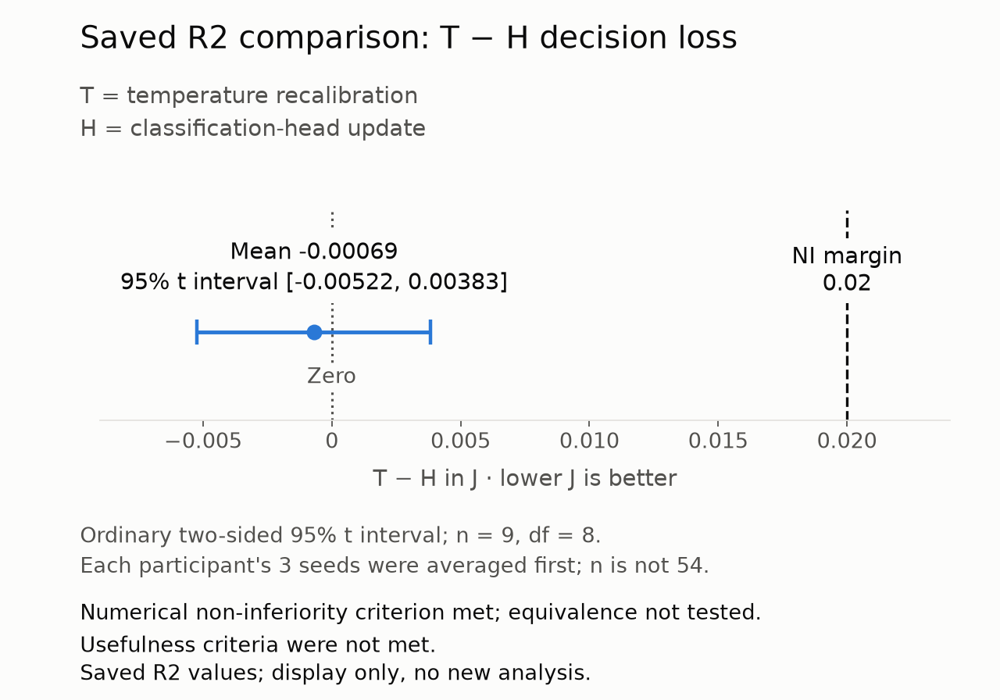
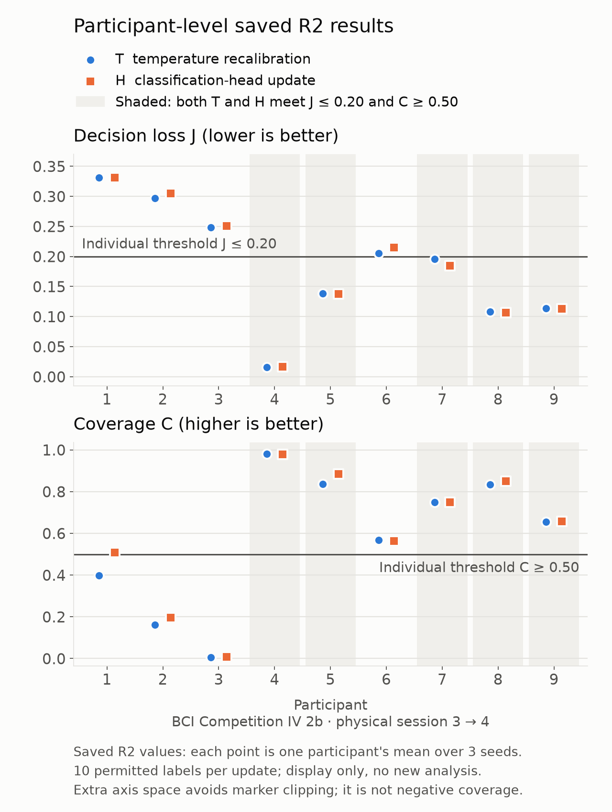

# EEG Cross-Session Selective Adaptation — R2 Pilot

**Shang-Wei Hung · offline pilot on public EEG · run `DREC01_CORE_VALIDATION_R2`, executed 2026-10-27**

When an EEG decoder is reused in a new session, a few labelled trials may be available to adapt it. Is it enough to recalibrate the decoder's confidence, or does the classifier itself need updating? And does either update make the decoder's accept-or-defer decisions useful? This repository reports one fixed, offline pilot of that question: its code, configuration, saved results, and the limits of what it shows.

> DREC01 is this project's internal name for the study; R2 is its second validation launch (the first, R1, stopped at start-up before reading any data). This page describes the R2 execution only. An earlier, broader DREC01 snapshot with different evidence and scope is kept in Git history; see [docs/HISTORY.md](docs/HISTORY.md).

## What was tested

- **Data.** Left- versus right-hand motor-imagery EEG from the nine participants of BCI Competition IV dataset 2b. For each person, a decoder trained on physical session 3 was adapted to physical session 4 ([data/README.md](data/README.md)).
- **Two updates.** **T** rescales the decoder's confidence with a single temperature. **H** refits the regularized classification head. Everything else in the decoder stays frozen.
- **Feedback budget.** Each update received and used the 10 permitted trial–label pairs at the first ten positions of a fixed 40-trial session-4 prefix. Evaluation used the same fixed trials for both methods, from trial index 40 onward. The 40-trial prefix only fixes where evaluation starts; neither method saw 40 labels.
- **Decision rule.** A prediction is accepted when its top-class probability is at least 0.75 and deferred otherwise. **Decision loss J** counts each accepted error as 1 and each deferral as 0.25, averaged over all evaluation trials; technically invalid outputs count as deferrals. **Coverage C** is the accepted share. These are proxy scores, not measures of human burden or harm.
- **Statistical unit.** Nine participants. Each person's three seeds (1103, 2207, 3301) were averaged first, then people were weighted equally. The 54 method instances (9 people × 3 seeds × 2 methods) are not 54 independent samples.

The protocol, thresholds and decision rules were fixed before this execution ([methods and limitations](docs/METHODS_AND_LIMITATIONS.md)).

## Main result

<!-- BEGIN GENERATED: group_table -->
| Quantity | Mean | 95% t interval (df = 8) | Pre-specified criterion | Met |
|---|---:|---:|---|---|
| T decision loss J | 0.1838 | [0.1069, 0.2608] | group upper bound < 0.20 | **no** |
| T coverage C | 0.5764 | [0.3240, 0.8288] | group lower bound > 0.50 | **no** |
| H decision loss J | 0.1845 | [0.1063, 0.2628] | group upper bound < 0.20 | **no** |
| H coverage C | 0.5995 | [0.3513, 0.8478] | group lower bound > 0.50 | **no** |
| T − H difference in J | −0.00069 | [−0.00522, 0.00383] | non-inferiority: upper bound < 0.02 | yes |
| Participants meeting J ≤ 0.20 and C ≥ 0.50 (T / H) | 5 / 5 of 9 | — | at least 7 of 9 | **no** / **no** |
<!-- END GENERATED: group_table -->



Saved R2 values, displayed without a new analysis: T − H in decision loss J, with the ordinary two-sided 95% t interval (nine participants; three seeds averaged within each person). The numerical non-inferiority criterion was met; equivalence was not tested and usefulness criteria were not met.



The participant figure shows the individual saved values in stacked panels. Extra axis space prevents marker clipping, including near-zero coverage; it does not indicate negative coverage.

**What this supports.** On the pre-specified numerical criterion, recalibration (T) was non-inferior to the head update (H): the upper end of the interval for the J difference lies well below the 0.02 margin. Equivalence was not tested. The protocol also required usefulness before T could be said to substitute for H: J ≤ 0.20 and C ≥ 0.50 in at least 7 of 9 participants, and group bounds below 0.20 for J and above 0.50 for C. Each method met the individual thresholds in only 5 of 9 participants and missed both group bounds. Usefulness was therefore not established (nor refuted), and substitution was not supported. The head update also failed to qualify as a useful fitted reference. Because both updates used the same ten labels, this pilot does not show that either one saves labels or shortens setup.

Exact values with their source fields, the nine-participant table, and the decision criteria are in [results/README.md](results/README.md).

## What the run records support, and what they do not

The fixed offline pipeline rebuilt the session-3 source models and, for each of the 54 adaptations, recorded the request, receipt and use of its permitted labels, the end of that access, the adapted state and the predictions. All predictions were sealed before the scorer obtained the evaluation labels. The reported statistics were then checked against the saved counts. A trusted data loader had loaded the complete data containers, including all labels, earlier in the same run. These records therefore support restricted label access *by the update methods* through the program's interfaces, not system-wide or operating-system isolation of evaluation labels. Preprocessing used completed offline buffers rather than causal streaming. The dataset is public and had been analysed before, so this is not a fresh blind test. The pilot did not test multimodal sensing, the added value of neural feedback, or benefit in a real human–AI interaction. See [docs/VALIDATION_SCOPE.md](docs/VALIDATION_SCOPE.md).

## My contribution

I framed the research question, selected the comparisons, coordinated execution, and reviewed the results; AI tools assisted with code integration and debugging. The record checks described in [docs/VALIDATION_SCOPE.md](docs/VALIDATION_SCOPE.md) were also AI-assisted.

## Repository guide

| Path | Contents |
|---|---|
| [docs/METHODS_AND_LIMITATIONS.md](docs/METHODS_AND_LIMITATIONS.md) | Data split, source models, T/H updates, feedback and sealing rules, metrics, aggregation, limitations |
| [results/](results/README.md) | Saved `primary_results.json`, group and participant tables (CSV), decision criteria, figure |
| [code/r2/](docs/CODE_AND_EVIDENCE_MAP.md) | The exact source files that ran in R2 (folder `candidate/`), with a map of what each file does |
| [docs/REPRODUCIBILITY.md](docs/REPRODUCIBILITY.md) | Three levels: saved results → tables; data + fitted states → predictions; data → full re-run |
| [docs/VALIDATION_SCOPE.md](docs/VALIDATION_SCOPE.md) | What was checked, by whom, and what has not been independently reproduced |
| [data/README.md](data/README.md) | Where to obtain the dataset and which files and sessions were used |
| [docs/HISTORY.md](docs/HISTORY.md) | The earlier DREC01 snapshot and how it differs from R2 |
| [THIRD_PARTY_NOTICES.md](THIRD_PARTY_NOTICES.md), [docs/RIGHTS_AND_DEPENDENCIES.md](docs/RIGHTS_AND_DEPENDENCIES.md) | Licence scope, dependencies, dataset terms |

To check the tables against the saved results, or to regenerate them (standard-library Python only):

```bash
python scripts/make_result_tables.py --check
```

Run it without `--check` to rewrite the CSV files.

No raw EEG, labels, trial-level predictions or model weights are included.

**Licence.** The code in `code/r2/` and the two scripts in `scripts/` are released under the MIT License ([code/r2/LICENSE](code/r2/LICENSE), [scripts/LICENSE](scripts/LICENSE)). This does not cover every file in the repository; the dataset and third-party packages keep their own terms. See [docs/RIGHTS_AND_DEPENDENCIES.md](docs/RIGHTS_AND_DEPENDENCIES.md).
